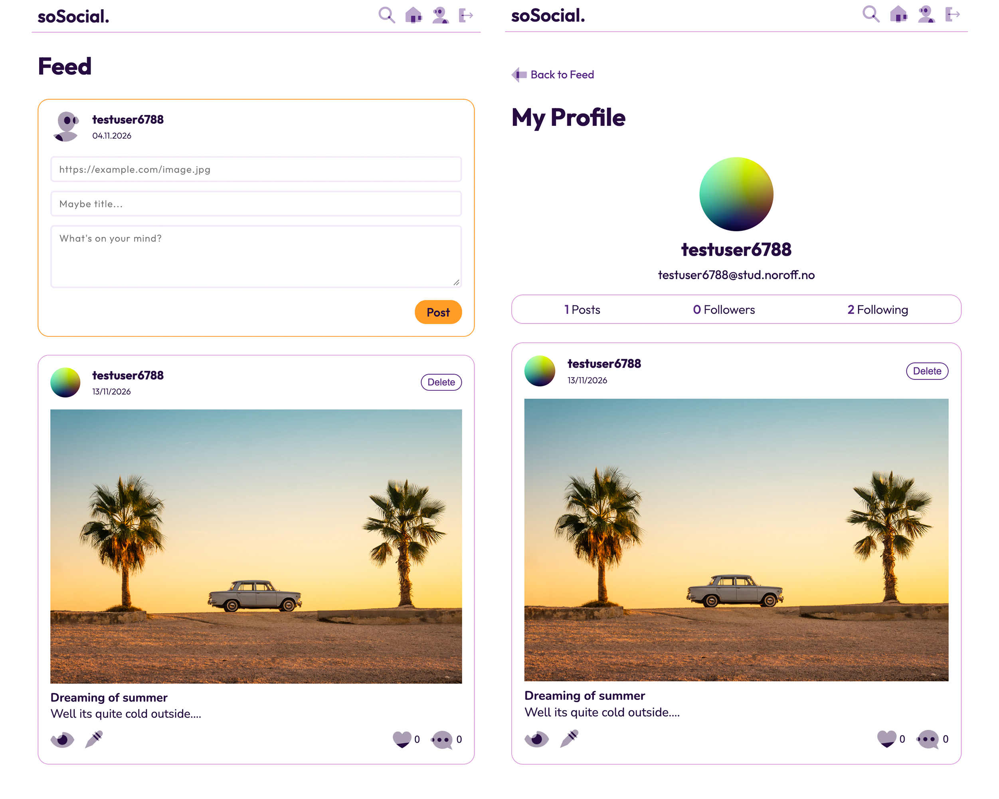

# soSocial.
### JavaScript 2 Course Assignment

## Screenshots

## Social media application

soSocial is a social media web application developed as part of my Front-End Development studies at Noroff.
The application allows users to register, log in, create and manage their own posts, comment and react on posts. Users can also view other profiles and follow or unfollow other users.
The project is built using HTML, CSS, and vanilla JavaScript, with the Noroff Social API v2 handling user authentication and social media data.

### Pages

- /index.html
- /register/index.html
- /login/index.html
- /post/index.html
- /profile/index.html

### Features

- **User Registration** - Create a new account.
- **Login and Logout** - Sign in to your account and log out when finished.
- **Post Feed** - View posts from other users.
- **Create Post** - Share posts with a title, text and optional image.
- **Edit and Delete Posts** - Manage your own posts.
- **Comments** - View and add comments to posts.
- **Reactions** - React to posts.
- **User Profiles** - View your own profile and other users profiles.
- **Follow and Unfollow** - Follow other users and unfollow them.
- **Search** - Search for posts by title or content.
- **Responsive Design** - Layout is responsive for different screen sizes.

### Technologies

- HTML5
- CSS3
- Vanilla JavaScript
- Noroff API
- LocalStorage

### Usage

1. **Register** - Create an account using a Noroff email address.
2. **Log in** - Sign in with your registrated credentials.
3. **Explore the Feed** - Browse post shared by other users.
4. **Create a Post** - Share your thoughts with a title, text and image.
5. **Manage Posts** - Edit or delete posts you have created.
6. **Interact with Posts** - Leave comments and react to posts.
7. **Explore Profiles** - Visit other users profiles and follow or unfollow them.
8. **Search Posts** - Use the search feature to find posts by title or content.
9. **Log out** - Sign out when you are finished.

### API

This project uses the Noroff API v2.

The API is used for:
  - User registration and login
  - Fetching, creating, editing, and deleting posts
  - Commenting on posts
  - Reacting to posts
  - Viewing user profiles
  - Following and unfollowing users

API documentation: `https://docs.noroff.dev/docs/v2`

### Authentication

soSocial uses the Noroff API v2 for user registration and login.

Users can register with a valid @stud.noroff.no email address and log in to access the application's features.

After logging in, an access token is stored in localStorage and used for authenticated API requests. Logging out removes the stored access token and username.

### View Online

- Live site: `https://krii41.github.io/JS2-CA/`
- GitHub repo: `https://github.com/Krii41/JS2-CA`

### Installation

1. Clone the repository
2. Open the project in VS Code
3. Run using Live Server

### Contact

Created by Urve Kriiva.